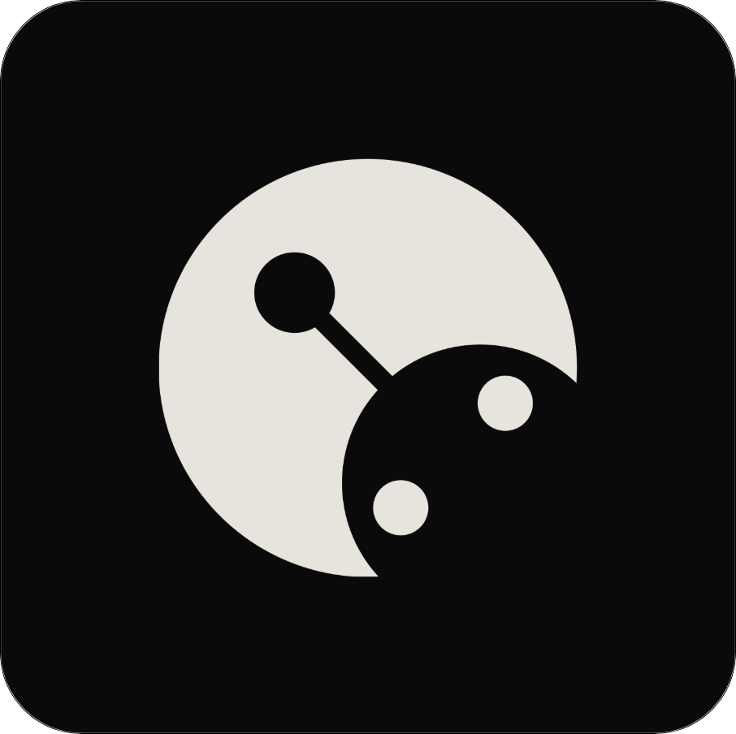

<div align="center">



# Cal AI

**AI calorie tracker for Android and iOS.** Take a photo of your meal, get calories and macros.


</div>

## Overview

Cal AI removes manual food logging. You photograph a meal, an AI vision model estimates the calories, protein, carbs and fats, and the app tracks your day against your personal goal.

## Screenshots

(Keep the existing table of onboarding `o1-o6` and tracking `h1-h4` screenshots.)

## Features

- **AI meal recognition:** photo in, nutrition estimate out
- **Daily dashboard:** intake vs. goal, with progress indicators and charts
- **Macro breakdown:** protein, carbs and fats per meal and per day
- **Meal history:** logged meals with timestamps
- **Personalized goals:** onboarding collects your data and sets targets
- **PDF export** (TODO: confirm, `fpdart`/pdf usage not verified)

## Tech stack

| Layer | Technology |
| --- | --- |
| Framework | Flutter, Dart |
| State management | Bloc / Cubit |
| Architecture | Feature-first, Clean Architecture, get_it for DI, fpdart for error handling |
| Navigation | go_router |
| AI | Groq API |
| Charts | fl_chart |
| Storage | Shared Preferences |
| Serialization | json_annotation |
| UI | flutter_screenutil, flutter_svg, google_fonts, cached_network_image |

## Project structure

```
lib/
├── main.dart
├── app_widgets/     # shared widgets
├── core/            # DI, networking, errors, utils
├── features/
│   ├── onboarding/
│   └── calories/
├── gen/             # generated assets
└── theme/
```

## Getting started

```bash
git clone https://github.com/eslamahmedfahmy/calories_scaner.git
cd calories_scaner
flutter pub get
flutter run --dart-define=GROQ_API_KEY=your_key_here
```

The API key is passed at build time and is never stored in the repo.

## Author

**Eslam Fahmy** · [LinkedIn](https://www.linkedin.com/in/eslam-ahmed-fahmy-340220202) · eslam50080@yahoo.com

MIT License.
